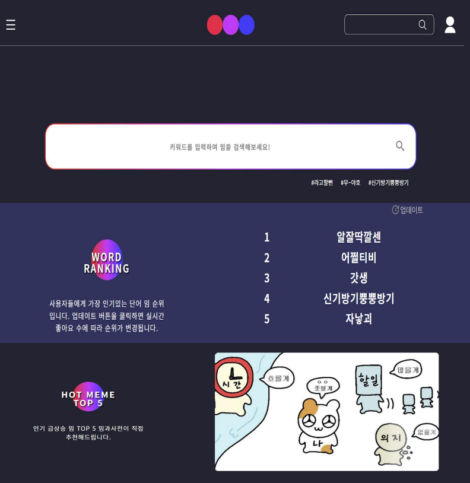
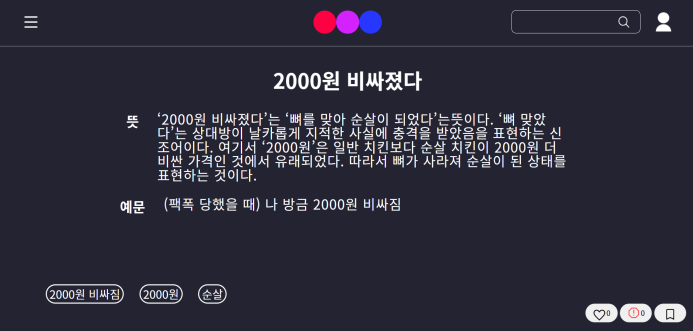
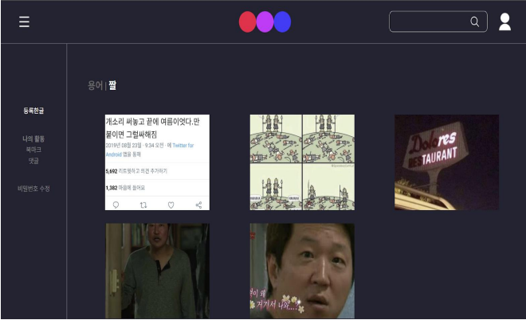

# 밈과사전 (MemeBackend)

인터넷 밈을 등록·검색할 수 있는 사전형 아카이빙 서비스의 백엔드 레포지토리

## 소개

- 빠른 유행 주기로 밈 문화를 따라가기 어려운 사람들을 위한 사전형 밈 아카이빙 서비스
- 세대 간 밈 정보 격차 해소 목적
- 혐오 표현이 담긴 밈의 무분별한 확산 방지 (신고 기능)

## 주요 기능

- 회원가입 / 로그인 (JWT 인증)
- 밈 등록, 검색, 타입(단어/짤)·카테고리(TV/영화/커뮤니티/기타)별 조회
- 좋아요 기반 밈 랭킹
- 북마크
- 댓글
- 신고 (누적 3회 이상 시 자동 삭제)
- 마이페이지 (본인 활동 확인, 비밀번호 수정, 회원 탈퇴)

## 서비스 화면

**메인 (밈 검색 / 랭킹)**



**밈 상세**



**타입/카테고리별 밈 목록**



## 기술 스택

- Spring Boot 2.1.9, Java 8
- Spring Security, JWT (jjwt)
- Spring Data JPA, MySQL
- AWS RDS, AWS S3 (Spring Cloud AWS)
- Git, Figma

## 폴더 구조

```
└─src
    └─main
        └─java/org/example/demo
            ├─config
            ├─domain
            │  ├─bookmark   : 북마크 entity
            │  ├─comment    : 댓글 entity
            │  ├─forbidden  : 금지단어 entity
            │  ├─user       : 회원 entity
            │  └─posts      : 게시글 entity
            ├─security
            ├─services
            │  ├─bookmark   : 북마크 추가/삭제, 중복 방지
            │  ├─comment    : 댓글 작성
            │  ├─forbidden  : 금지단어 필터링, 신고 게시글 삭제
            │  ├─main       : 랭킹
            │  ├─user       : 회원가입/로그인/로그아웃/탈퇴/마이페이지
            │  └─posts      : 게시글 작성, 타입/카테고리별 조회, 키워드 검색, 상세 조회
            └─web
                ├─controller : API
                └─dto
```

## 진행 기간

2022.03 ~ 2022.06 (서비스 기획부터 배포까지)

## 팀 구성

프론트엔드 2인, 백엔드 2인으로 구성된 4인 팀 프로젝트입니다.
